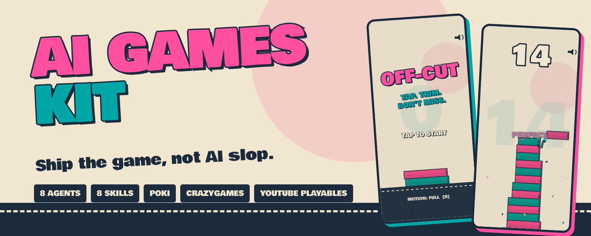
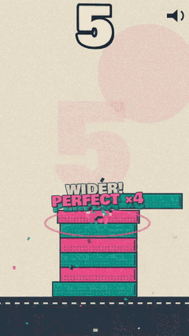
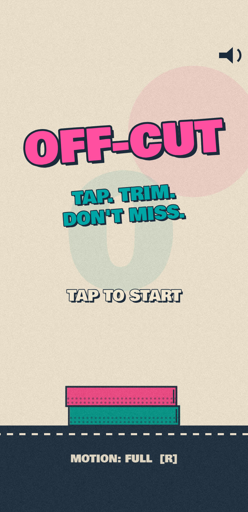
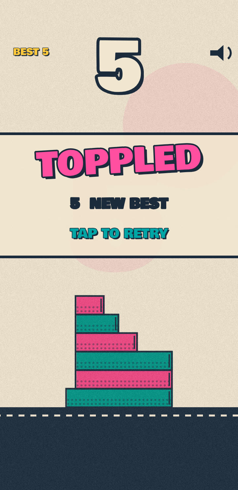
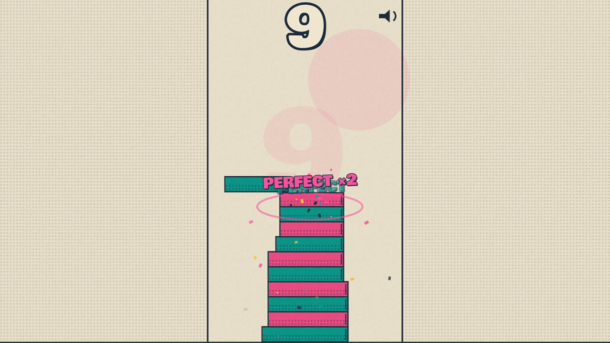
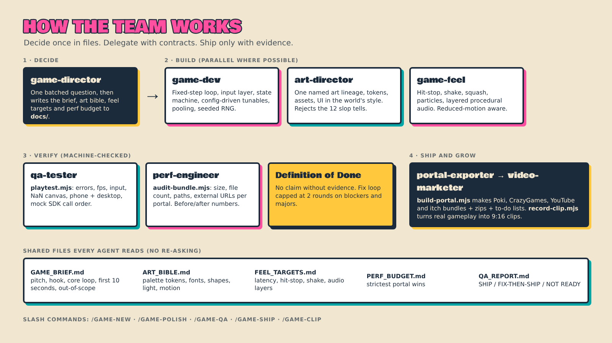

<p align="center"></p>

# AI Games Kit

**A team of AI agents + skills for [Claude Code](https://claude.com/claude-code) that ships high-quality web games with far less back-and-forth.**

It gives Claude Code a game studio's worth of specialists (director, gameplay engineer, art director, game-feel designer, QA, performance, portal exporter, video marketer) plus the scripts that *prove* the work is good: smoke tests, bundle audits per portal, SDK call-order checks and a gameplay recorder for short-form video.

- 🎨 **Games that don't look or feel AI-made.** A written art direction, a 12-point "slop tell" checklist, and a game-feel pass with tunable values.
- 📦 **One build per portal.** Poki, CrazyGames, YouTube Playables and itch.io bundles from one source tree, audited against each portal's size and file rules.
- 🎬 **Short-form videos from real gameplay.** Record 9:16 footage with an autoplay bot, cut hooks, write the posting plan.
- 💸 **Fewer tokens, fewer re-prompts.** Decisions live in files, agents get contracts, and "done" requires machine-checked evidence.

> **Status:** the scripts, adapters and example game are tested end to end (everything shown below is real output). The agents and skills are written to drive that same tooling, but your first `/game-new` is the first full run of the agent pipeline. Please [open an issue](../../issues) if something feels off.

## The final output

Everything below was built and checked **with the kit**: a complete example game, [OFF-CUT](examples/offcut), exported to four portals.

<p align="center">
  
  &nbsp;
  
  &nbsp;
  
</p>

<p align="center"></p>

- **Game:** [`examples/offcut`](examples/offcut): 40 KB total, no dependencies, risograph print look, procedural audio.
- **Portal bundles:** `node scripts/build-portal.mjs examples/offcut --portal all` produces `dist/{poki,crazygames,youtube,itch}` + zips, all passing the audit and the mock-SDK playtest.
- **Marketing clip:** [`examples/offcut-marketing/offcut-bot.mp4`](examples/offcut-marketing/offcut-bot.mp4) (1080×1920, 60 fps, recorded by the kit's bot).

## Try it in 2 minutes (no Claude needed)

```bash
git clone https://github.com/chakitp/ai-games-kit.git && cd ai-games-kit
npm install && npx playwright install chromium

npm run demo:serve     # play OFF-CUT at http://localhost:8080  (add ?bot=1 to watch the bot)
npm run demo:build     # build Poki / CrazyGames / YouTube / itch bundles into dist/
npm run demo:audit     # audit the Poki bundle
npm run demo:test      # playtest it against a fake Poki SDK
```

## Use it on your own game (step by step)

The full illustrated walkthrough is in **[docs/getting-started.md](docs/getting-started.md)**. The short version:

| # | Step | Command |
|---|------|---------|
| 1 | Install the plugin in Claude Code | `/plugin marketplace add chakitp/ai-games-kit` then `/plugin install ai-games-kit@ai-games-kit-marketplace` |
| 2 | Scaffold a game project | `node scripts/init-game.mjs ../my-game` |
| 3 | Install test tooling | `cd ../my-game && npm install && npx playwright install chromium` |
| 4 | Build the game with the team | `claude` → `/game-new "your one-line idea"` |
| 5 | Check it, look at the screenshots | `npm run playtest` (or `/game-qa`) |
| 6 | Polish art, feel and performance | `/game-polish` |
| 7 | Export per portal | `/game-ship poki,crazygames,youtube,itch` |
| 8 | Make launch videos | `/game-clip` |

## How the team works

<p align="center"></p>

More detail: **[docs/how-it-works.md](docs/how-it-works.md)**.

## What's inside

| | |
|---|---|
| **Agents** (`agents/`) | `game-director`, `game-dev`, `art-director`, `game-feel`, `qa-tester`, `perf-engineer`, `portal-exporter`, `video-marketer` |
| **Skills** (`skills/`) | `game-brief`, `web-game-architecture`, `anti-slop-art`, `game-feel`, `qa-playtest`, `perf-budget`, `portal-export`, `short-form-video` |
| **Commands** (`commands/`) | `/game-new`, `/game-polish`, `/game-qa`, `/game-ship`, `/game-clip` |
| **Scripts** (`scripts/`) | `init-game`, `build-portal`, `audit-bundle`, `playtest`, `record-clip` (+ `mock-sdks/`) |
| **Adapters** (`platforms/`) | `poki`, `crazygames`, `youtube`, `itch`, `none`: one contract, no-ops when the SDK is absent |
| **Example** (`examples/`) | OFF-CUT game + its marketing clip |

## Portals

| Portal | Access | Initial size | What the kit does |
|---|---|---|---|
| Poki | Curated, web-exclusive | target < 8 MB | Adapter, SDK injection, audit, call-order test |
| CrazyGames | Open submit (Basic → Full Launch) | ≤ 50 MB (≤ 20 MB for mobile homepage) | Adapter, audit, call-order test |
| YouTube Playables | Invitation + certification | < 30 MiB (< 15 MiB recommended) | Adapter, filename/size audit, ready-order test |
| itch.io | Open | 500 MB extracted | Plain bundle + zip |

> **Portal rules change.** The numbers were verified on 2026-11-05 and the exporter agent re-checks the live docs each run. SDK method names in the adapters are verified only against offline mocks here; confirm them against each portal's current SDK reference before submitting. Details and caveats: [docs/portals.md](docs/portals.md).

## Docs

- [Getting started (illustrated, step by step)](docs/getting-started.md)
- [How it works](docs/how-it-works.md)
- [Portals and adapters](docs/portals.md)
- [Troubleshooting](docs/troubleshooting.md)
- [Contributing](CONTRIBUTING.md)

## License

MIT, see [LICENSE](LICENSE). The example game bundles the Bowlby One font (SIL OFL 1.1).
