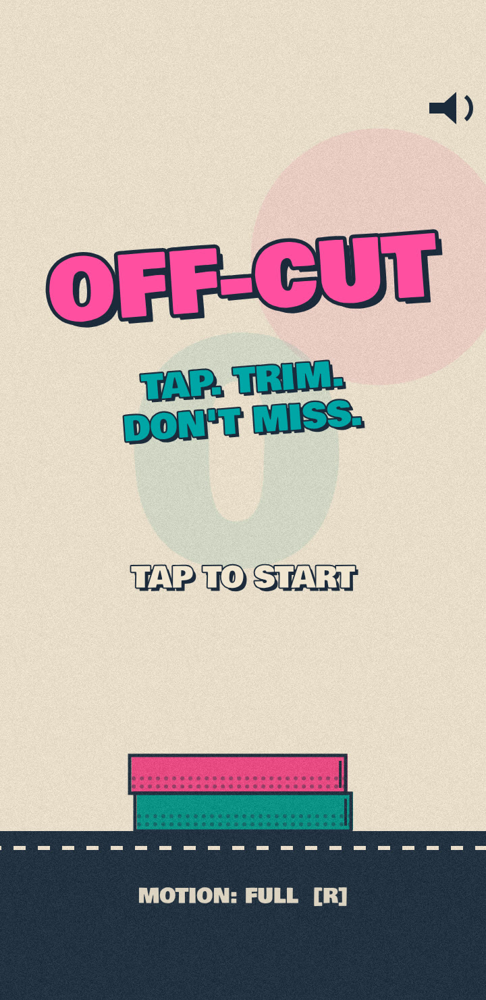
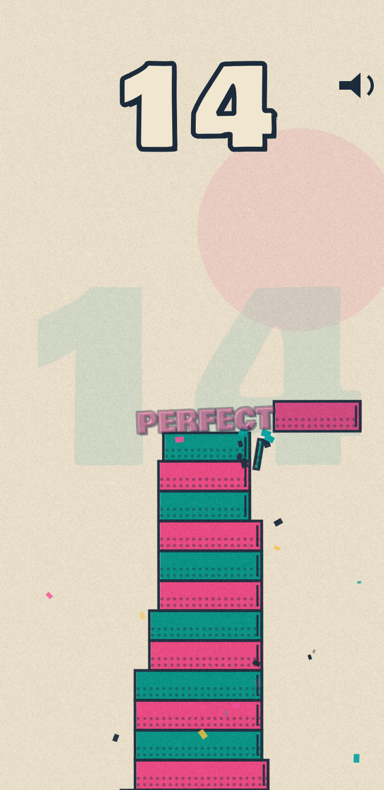
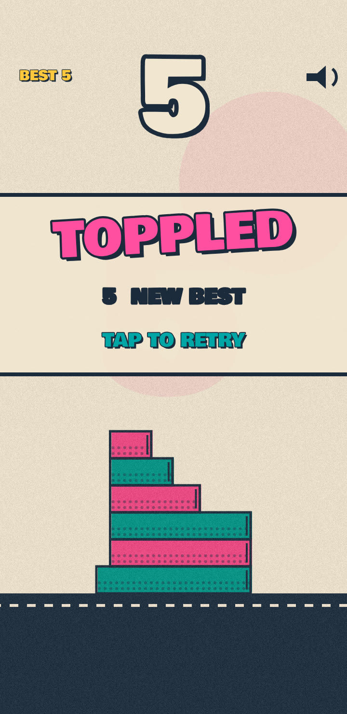
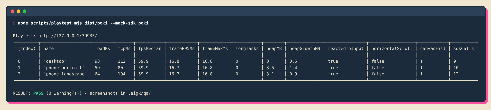
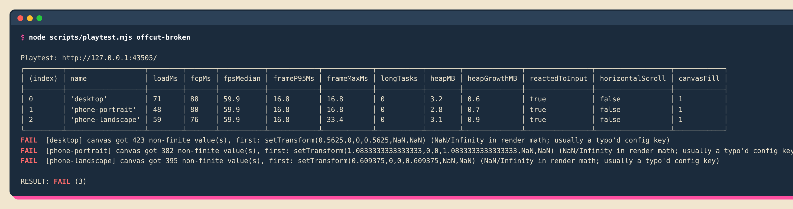
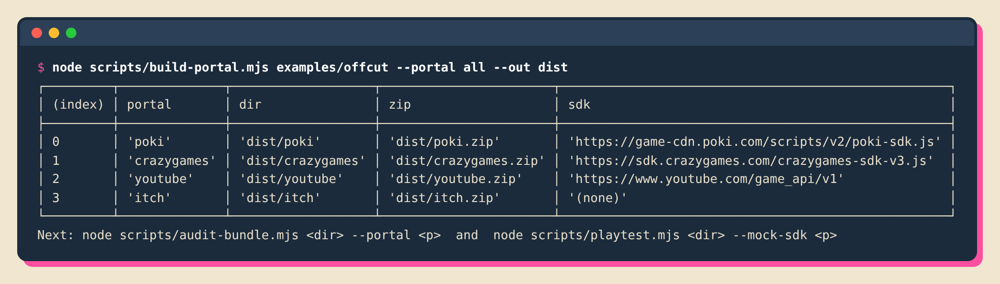
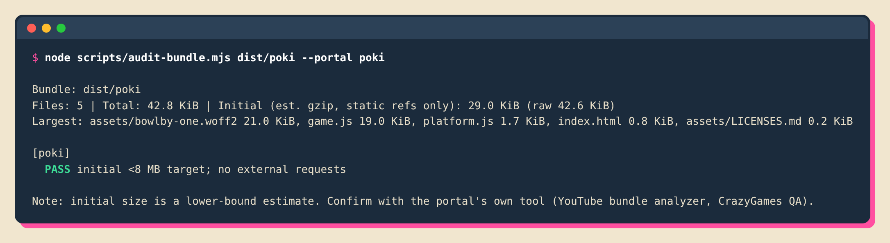
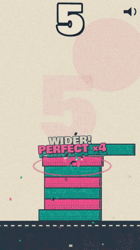

# Getting started: step by step

This guide takes you from nothing to a portal-ready game and a launch video. Screenshots and terminal output below are **real output** from building the example game OFF-CUT with this kit.

**You need:** [Claude Code](https://claude.com/claude-code), Node.js 20+, git. Optional: `ffmpeg` (turns recordings into mp4) and `zip` (bundles are zipped if it's installed).

> **Status.** The scripts, adapters and example game are tested end to end (shown below). The agents and skills are written to drive that same tooling; your first `/game-new` is the first real run of the full agent pipeline, so please [open an issue](../../../issues) with anything that feels off.

---

## 0. Try the example first (2 minutes, no Claude needed)

```bash
git clone https://github.com/chakitp/ai-games-kit.git
cd ai-games-kit
npm install && npx playwright install chromium
npm run demo:serve
```

Open <http://localhost:8080>. This is OFF-CUT: tap to drop the sliding slab, overhang gets trimmed, perfect drops keep your width. Add `?bot=1` to watch the autoplayer.

<p align="center">



</p>

---

## 1. Install the plugin in Claude Code

Inside Claude Code:

```
/plugin marketplace add chakitp/ai-games-kit
/plugin install ai-games-kit@ai-games-kit-marketplace
```

Working from a local clone instead? Use the path: `/plugin marketplace add ./ai-games-kit`.

You now have 8 agents, 8 skills and 5 slash commands (`/game-new`, `/game-polish`, `/game-qa`, `/game-ship`, `/game-clip`). If your Claude Code version namespaces plugin commands, they appear as `/ai-games-kit:game-new` and so on.

## 2. Scaffold your game project

From the kit folder:

```bash
node scripts/init-game.mjs ../my-game --name "My Game"
cd ../my-game
npm install && npx playwright install chromium
```

`init-game` copies the scripts, portal adapters and a `CLAUDE.md` with the project rules, and writes a `package.json` with handy npm scripts. It never overwrites existing files.

## 3. Build the game with the team

```bash
claude
```

then:

```
/game-new "a one-thumb stacking game where the tower is made of leftovers"
```

What happens (see the [pipeline](how-it-works.md)):

1. **`game-director`** asks **one** batched question at most (core verb, target portals, art direction pick, session shape) and decides everything else, recording assumptions.
2. It writes the decisions to `docs/`: `GAME_BRIEF.md`, `ART_BIBLE.md`, `FEEL_TARGETS.md`, `PERF_BUDGET.md`. Every other agent reads these instead of re-asking you.
3. **`game-dev`**, **`art-director`** and **`game-feel`** build a playable vertical slice: one level, fail and win states, restart in under 2 seconds.
4. **`perf-engineer`** and **`qa-tester`** measure it and report with evidence, not claims.

You review the result in a browser. Changes you want go into the docs first (`ART_BIBLE.md`, `FEEL_TARGETS.md`), then the agents apply them: that is how the kit avoids re-prompting the same fixes.

## 4. Run the checks yourself

```bash
npm run playtest
```

The smoke test opens the game on **desktop, portrait phone and landscape phone**, taps and presses keys, samples frame times and takes screenshots into `.aigk/qa/`.

<p align="center"></p>

It fails on console errors, failed requests, low fps, horizontal scroll, no reaction to input, and **NaN/Infinity reaching canvas calls**. That last check exists because of a real bug found while building the example: a mistyped config key made every transform NaN, the browser silently ignored it, and the whole world rendered unscaled. Here is what the kit prints when it catches it:

<p align="center"></p>

> **Always open the screenshots in `.aigk/qa/`.** A passing report is not a visual review.

## 5. Polish

```
/game-polish
```

Runs QA baseline → art-director (slop-tell review of your screenshots, top 3 visual fixes) → game-feel (missing juice, tunables in config) → perf-engineer (measure, fix top costs, before/after table) → QA again. Use `/game-polish art`, `feel` or `perf` to focus.

## 6. Export per portal

```
/game-ship poki,crazygames,youtube,itch
```

or by hand:

```bash
npm run build:all
```

<p align="center"></p>

`build-portal` ships everything in the folder you point it at **except** the kit's own tooling and project config (`scripts/`, `platforms/`, `package.json`, `docs/`, `marketing/`, `*.md`, sourcemaps). If you use a bundler such as Vite, point it at the build output folder (the one containing `index.html`).

Each `dist/<portal>/` contains only that portal's adapter and SDK tag, a `_submission/` folder with a listing draft and a human to-do list, and a matching zip with `index.html` at the root.

Audit a bundle against that portal's limits:

```bash
node scripts/audit-bundle.mjs dist/poki --portal poki
```

<p align="center"></p>

Then run the playtest against the real build with an offline fake of the portal SDK. It records every SDK call and fails on duplicate or missing events:

```bash
node scripts/playtest.mjs dist/poki --mock-sdk poki
```

## 7. Make launch videos

```
/game-clip
```

or:

```bash
npm run clip
```

The recorder loads your game with `?clip=1` (bot plays, clean HUD), records 9:16 video with Playwright, and converts to 1080×1920 60 fps mp4 if `ffmpeg` is installed. The `video-marketer` agent then cuts three hook variants (satisfying / clutch / challenge), adds captions inside the safe zones and writes `marketing/POSTING_PLAN.md`.

<p align="center"></p>

Full-quality example: [`examples/offcut-marketing/offcut-bot.mp4`](../examples/offcut-marketing/offcut-bot.mp4).

## 8. Submit

Open `dist/<portal>/_submission/TODO-human.md` for the portal's remaining manual steps (accounts, forms, thumbnails, review waits). The kit cannot publish for you: Poki and YouTube Playables are curated or invitation-based, and CrazyGames needs your account.

---

### Make your own game "portal-ready" by hand

If you don't use the agents, the only thing a game must do is talk to `window.__PLATFORM__` instead of a portal SDK. See [`examples/offcut/game.js`](../examples/offcut/game.js) for a reference integration and [portals.md](portals.md) for the contract.
