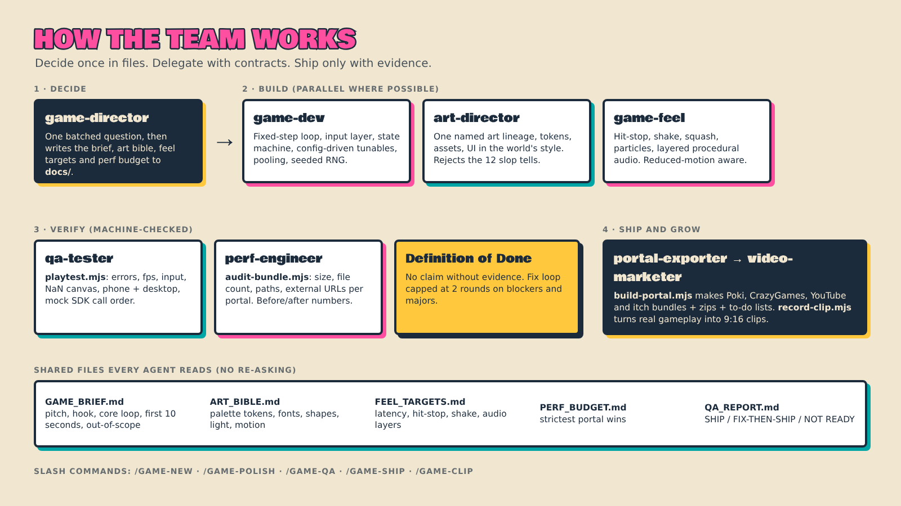

# How it works

## Principles

1. **Decide once, in files.** Brief, art bible, feel targets and perf budget live in `docs/`. Agents read them; nobody re-asks, so you stop re-prompting the same fixes.
2. **Delegate with contracts.** The director gives each specialist its inputs (files), one deliverable, acceptance criteria and what *not* to touch. Reports come back under ~150 words plus the changed files.
3. **Evidence, not claims.** "Done" means the Definition of Done is machine-checked: playtest passes, audit passes, slop-tell checklist has zero critical tells, feel P0 items present.
4. **Progressive disclosure keeps tokens down.** Skills are short; portal rules live in `skills/portal-export/references/` and are only loaded for the portal in question.
5. **Fix loops are capped** at two rounds on blockers and majors.

## Agents

| Agent | Owns | Typical output |
|---|---|---|
| `game-director` | Brief, orchestration, Definition of Done | `docs/*.md`, evidence table |
| `game-dev` | Loop, input, state, levels, saves, difficulty | Game code, `config.js` |
| `art-director` | Visual identity, assets, UI, slop review | `ART_BIBLE.md`, theme tokens, assets |
| `game-feel` | Juice and audio | Effects + `feel.*` tunables |
| `qa-tester` | Smoke + exploratory testing | `QA_REPORT.md` with a SHIP / FIX-THEN-SHIP / NOT READY verdict |
| `perf-engineer` | Size, load time, frame time, memory | Before/after table |
| `portal-exporter` | Per-portal builds and submission kits | `dist/<portal>/`, zips, `_submission/` |
| `video-marketer` | Short-form clips and posting plan | `marketing/clips/`, `POSTING_PLAN.md` |

## Skills

`game-brief` · `web-game-architecture` · `anti-slop-art` · `game-feel` · `qa-playtest` · `perf-budget` · `portal-export` · `short-form-video`. Each is a `SKILL.md` an agent loads on demand.

## Anti-slop, concretely

The `anti-slop-art` skill treats "slop" as the average of everything and fixes it with **specificity, constraint and craft**:

1. Commit to a named art lineage (risograph two-ink print, sumi-e ink, blueprint...), never an adjective pile.
2. Tokenize: ≤ 6 colors with roles, two fonts, one shape language, one light direction, one motion personality.
3. Build the hero frame first and review it against 12 critical tells (neon-gradient-on-black, emoji sprites, default fonts, glass cards, linear motion, silent audio...).
4. Only then produce the rest of the assets.

## Scripts

| Script | What it does |
|---|---|
| `init-game.mjs` | Scaffold a game project with the kit's scripts, adapters and rules |
| `build-portal.mjs` | Build `dist/<portal>/` with the right adapter + SDK tag, `_submission/`, zip |
| `audit-bundle.mjs` | Size, file count, absolute paths, filenames, external URLs, debug leftovers per portal |
| `playtest.mjs` | Desktop + phone smoke test, fps, NaN canvas check, `--mock-sdk` call-order validation |
| `record-clip.mjs` | Record 9:16 gameplay (bot or scripted actions) → mp4 |

All scripts are plain Node (ES modules) with no dependencies except Playwright for `playtest` and `record-clip`.
